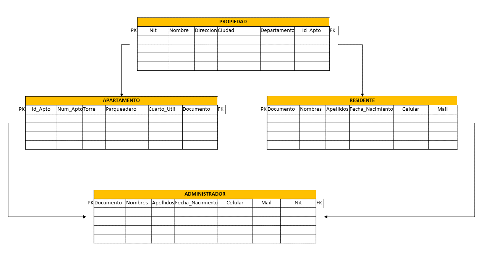

# ADopera

### Sistema Integral de Administración de Unidades Residenciales

[](##estado-del-proyecto)
[](#stack-tecnológico)

> Aplicación web interactiva orientada a centralizar y optimizar
> procesos cotidianos de administración residencial para
> administradores, residentes y personal de portería.

## Tabla de contenidos 

-   [1. Estado del proyecto](#1-estado-del-proyecto)
-   [2. Resumen ejecutivo](#2-resumen-ejecutivo)
-   [3. Arquitectura del sistema](#3-arquitectura-del-sistema)
-   [4. Modelo de datos](#4-modelo-de-datos)
-   [5. Stack tecnológico](#5-stack-tecnológico)
-   [6. Guía de configuración e
    instalación](#6-guía-de-configuración-e-instalación)
-   [7. Flujo de trabajo y control de
    versiones](#7-flujo-de-trabajo-y-control-de-versiones)
-   [8. Licencia y créditos](#8-licencia-y-créditos)

## 1. Estado del proyecto

-   **Nombre:** ADopera: Sistema Integral de Administración de
    Unidades Residenciales.
-   **Estado:** En desarrollo
-   **Versión:** \[1.0\].

## 2. Resumen ejecutivo

### Problema identificado

En muchas unidades residenciales, los procesos administrativos se
realizan mediante métodos tradicionales, como la distribución física de
recibos de administración, la solicitud manual de reservas de zonas
comunes y el registro de visitantes en libros o planillas. Estas
prácticas pueden ocasionar desorganización, pérdida o desactualización
de información, demoras en la atención y dificultades de comunicación
entre los residentes y la administración.

### Solución propuesta

ADopera Web propone una interfaz web modular, intuitiva y dinámica,
desarrollada con HTML, CSS, Maven, vaadin, SQL, Java y JavaScript moderno. La aplicación
representa un entorno de trabajo con tres perfiles principales
---Administrador, Residente y Porteria---, cada uno con opciones
ajustadas a sus necesidades operativas.

La solución funciona del lado del cliente y utiliza estructuras de datos de JavaScript para gestionar información temporalmente. 
### Objetivo principal

Automatizar y simplificar tareas cotidianas de la gestión residencial
mediante una plataforma web que permita consultar, filtrar y actualizar
información relacionada con usuarios, recibos, reservas y PQRS.

### Funcionalidades principales

#### Módulo de Administrador

-   Gestión general de residentes.
-   Generación y control de recibos de administración.
-   Asignación y seguimiento de solicitudes o PQRS.
-   Supervisión general de la información del sistema.

#### Módulo de Residente

-   Consulta de recibos de administración.
-   Descarga simulada de recibos.
-   Solicitud de reservas de zonas comunes.
-   Radicación de peticiones, quejas, reclamos o sugerencias (PQRS).

#### Módulo de Portería

-   Registro y control de ingreso de visitantes.
-   Registro de paquetería.
-   Gestión de novedades relacionadas con la portería.

### Valor para los usuarios

-   **Administración:** potencial reducción de errores manuales, mejor
    seguimiento de solicitudes y optimización del tiempo de atención.
-   **Residentes:** consulta de información y gestión de solicitudes
    desde la interfaz web, sin tener que acudir presencialmente a la
    oficina administrativa.
-   **Portería:** centralización digital de los registros de acceso,
    paquetería y novedades.

> **Alcance importante:** las funciones descritas representan las
> capacidades previstas o simuladas en el proyecto. La persistencia de
> datos, la autenticación segura y el funcionamiento en producción no
> están confirmados con la información suministrada.

## 3. Arquitectura del sistema

### Descripción general
Aplicación monolítica del lado del cliente (*client-side monolith*). La interfaz se representa en el navegador mediante HTML y CSS, mientras que JavaScript se encarga de la lógica de interacción, el procesamiento de datos temporales y la actualización dinámica de la página.


### Componentes principales

  -----------------------------------------------------------------------
  Componente                          Responsabilidad
  ----------------------------------- -----------------------------------
  Presentación (HTML y CSS)           Estructurar la interfaz, los
                                      formularios, las tablas y las
                                      vistas para los diferentes roles.

  Gestión de roles                    Determinar el perfil seleccionado o
                                      validado y mostrar las opciones
                                      correspondientes. El mecanismo
                                      exacto de autenticación está
                                      pendiente de confirmar.

  Estructuras de datos (JavaScript)   Representar temporalmente registros
                                      de usuarios, recibos y reservas
                                      mediante arreglos y objetos
                                      literales.

  Filtrado y búsqueda                 Consultar y filtrar registros
                                      mediante métodos como `map()`,
                                      `filter()` y `find()`, según el
                                      caso de uso.

  Manejo de eventos y DOM             Capturar interacciones, procesar
                                      formularios y actualizar
                                      dinámicamente el contenido visible.

  Validación de datos                 Aplicar funciones lógicas y
                                      expresiones regulares cuando
                                      corresponda.
  -----------------------------------------------------------------------

### Flujo de interacción

1.  El usuario interactúa con la interfaz, por ejemplo, seleccionando
    una opción o diligenciando un formulario.
2.  JavaScript captura el evento y valida los datos ingresados.
3.  La aplicación procesa la información y, cuando corresponde,
    actualiza el arreglo u objeto asociado.
4.  El DOM se actualiza para reflejar los cambios en la tabla o el panel
    correspondiente, sin recargar la página.


## 4. Modelo de datos

registros de usuarios, recibos, reservas y PQRS, gestionados mediante arreglos y objetos de JavaScript.Sin embargo, esta pendiente el esquema definitivo de entidades, sus atributos, las claves ni las cardinalidades.

Por esta razón, no se presenta un diagrama entidad-relación como si
fuera el modelo implementado.

### Diagrama MER

El siguiente diagrama representa la estructura de la base de datos, sus entidades y las relaciones establecidas entre ellas.



## 5. Stack tecnológico

  -----------------------------------------------------------------------
  Tecnología o            Versión utilizada       Propósito
  herramienta                                     
  ----------------------- ----------------------- -----------------------
  HTML                    \[Información pendiente Estructura de las
                          de confirmar\]          páginas y componentes
                                                  de la interfaz.

  CSS                     \[Información pendiente Presentación visual y
                          de confirmar\]          estilos responsivos.

  JavaScript              JavaScript moderno;     Lógica de interacción,
                          versión exacta          gestión temporal de
                          pendiente               datos, validaciones y
                                                  actualización del DOM.

  Git                     \[Información pendiente Control de versiones,
                          de confirmar\]          si está incorporado al
                                                  flujo del equipo.

  GitHub                  \[Información pendiente Alojamiento y
                          de confirmar\]          colaboración sobre el
                                                  repositorio, si aplica.
  
                                                  
  -----------------------------------------------------------------------


## 6. Guía de configuración e instalación

### Requisitos previos

 aplicación web basada en HTML, CSS y JavaScript. Para abrir archivos web estáticos se necesita un navegador moderno. El uso de un editor de código es recomendable, pero el editor específico no está confirmado.

-   Navegador web moderno.
-   Archivos fuente del proyecto.
-   Editor de código, opcional para la visualización y modificación de
    los archivos.

### Instalación y ejecución local

1.  Obtén el proyecto desde la carpeta o repositorio proporcionado por
    el equipo.
2.  Ubica el archivo HTML principal. Su nombre y ruta están pendientes
    de confirmar.
3.  Abre el archivo HTML en un navegador moderno.

el proyecto dispone de un repositorio Git, también puede clonarse con
el siguiente comando, reemplazando la URL de ejemplo por la dirección
real:

``` bash
git clone <https://github.com/Brandon-Gonzalez98/proyecto-integrador-b1-2026-2-g3.git>
cd <CARPETA_DEL_PROYECTO>
```


### Base de datos

Pendiente de construccion 


### Información necesaria para completar esta guía

-   Nombre y ubicación del archivo HTML de entrada. Pendiente
-   Estructura real de carpetas. Pendiente
-   [URL del repositorio](https://github.com/Brandon-Gonzalez98/proyecto-integrador-b1-2026-2-g3.git)


### Flujo sugerido con Git

1.  Mantener una rama principal estable, por ejemplo `main`.
2.  Crear ramas independientes para cambios concretos, por ejemplo
    `feature/reservas` o `fix/validacion-formulario`.
3.  Realizar cambios pequeños y guardar avances con mensajes
    descriptivos.
4.  Revisar y probar los cambios antes de integrarlos en la rama
    principal.
5.  el equipo trabaja con GitHub, utilizara *pull requests* para
    revisar las modificaciones antes de fusionarlas.
6.  Mantener actualizado el archivo README cuando cambien la
    instalación, la arquitectura o las funcionalidades.

### Comandos básicos de referencia

``` bash
# Consultar el estado de los archivos
git status

# Preparar los cambios
git add .

# Registrar los cambios
git commit -m "Describe el cambio realizado"

# Consultar las ramas disponibles
git branch
```

## 7. Licencia y créditos

### Equipo de trabajo

  -----------------------------------------------------------------------
  Integrante                          Rol o responsabilidad
  ----------------------------------- -----------------------------------
  \[Brandon alexis gonzalez Osorio \] \[Programacion fron end \]
  \[Hector Alexis Noreña Osorio\]     \[Programacion de base de datos \]
  \[Diego Sanabria\]                  \[Programacion Backend\]
  ----------------------------------------------------------------------


